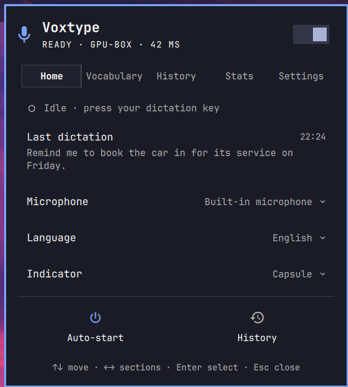

# My Voxtype

An Omarchy bar widget and panel for [Voxtype](https://github.com/peteonrails/voxtype)
dictation, two recording indicators, and (optionally) the server side for
running transcription and clean-up on a GPU machine on your tailnet.



The panel's layout is inspired by Superwhisper's settings window; it contains
none of Superwhisper's code or artwork. The design follows the author's other
Omarchy plugins.

## What's in the repo

| Path | Runs on | What it is |
|---|---|---|
| `BarWidget.qml`, `Panel.qml`, `Service.qml`, `Model.js` | the machine you dictate on | The bar icon and keyboard-driven panel |
| `post_process.sh` | same | Voxtype's post-process hook: joins lines, drops Whisper's sound tags, optional clean-up, history |
| `shortcuts.lua` | same | Hyprland: Escape cancels a recording; optional hold-to-talk key |
| `osd/edge-glow`, `osd/pill` | same | Two Voxtype OSD style packages (recording indicators) |
| `server/` | a GPU machine (optional) | whisper-server package recipe, the `dictation-correct` clean-up service, systemd units. See [`server/README.md`](server/README.md) |

## Features

- **Bar icon:** dim when Voxtype is off, plain when ready, accent while
  recording, pulsing while transcribing, urgent when a remote server can't be
  reached. Left click opens the panel, right click starts/stops Voxtype.
- **Header:** status line (`READY · GPU-BOX · 42 MS`, `RECORDING · 0:07`,
  `GPU-BOX UNREACHABLE`) and a switch that starts/stops the daemon.
- **Home:** live card while recording, last dictation (Enter copies),
  microphone (the system default input), language and indicator style (each
  opens a list to pick from), Auto-start and History buttons.
- **Vocabulary:** *terms* (kept in `whisper.initial_prompt`) and
  *replacements* (`[text.replacements]`), add and remove (asks first).
- **History:** saved dictations, copy, delete, clear all.
- **Stats:** words today / this week / all time, dictations, speaking speed,
  median response time.
- **Settings:** save history, Escape cancels, pause media, press Enter after
  typing (off / always / when you say "submit"), an optional hold-to-talk
  key, longest recording, server timeout, the history hook, open the config.
- A desktop notification when a recording starts while the server is
  unreachable.
- **Indicators:** **Edge glow** (a soft accent mist rises from the bottom of
  the focused window and up its sides, swelling with your voice; a highlight
  sweeps along the bottom while transcribing; Hyprland only, as it asks
  `hyprctl` for the focused window) and **Pill** (a small outlined pill at
  the bottom centre with voice bars).
- **Clean-up (optional):** with `server/dictation-correct` running, each
  dictation is cleaned by a small local LLM (misheard words from your
  vocabulary, punctuation, fillers, self-corrections) in about 0.3 s. It
  never answers or obeys what you dictate, and the uncorrected text is typed
  whenever anything goes wrong.

Settings with a fixed set of values open an inline list; only the value you
pick is saved, once, followed by a single Voxtype restart.

## Install

```bash
git clone https://github.com/lunardi0x01/omarchy-voxtype ~/Projects/omarchy-voxtype
ln -s ~/Projects/omarchy-voxtype ~/.config/omarchy/plugins/lunardi0x01.voxtype
omarchy plugin enable lunardi0x01.voxtype --after omarchy.tray
```

Then wire up the helpers:

```bash
P=~/.config/omarchy/plugins/lunardi0x01.voxtype
# History, line joining, sound-tag removal, optional clean-up
# (Settings → History hook does this too)
voxtype config set output.post_process.command "$P/post_process.sh"
voxtype config set output.post_process.timeout_ms 3500
# The Edge glow and Pill indicators
mkdir -p ~/.local/share/voxtype/osd
ln -sfn $P/osd/edge-glow ~/.local/share/voxtype/osd/edge-glow
ln -sfn $P/osd/pill ~/.local/share/voxtype/osd/pill
# Escape-to-cancel and the hold-to-talk key
ln -sfn $P/shortcuts.lua ~/.config/voxtype/shortcuts.lua
systemctl --user restart voxtype && hyprctl reload
```

To stop Voxtype re-linking its own settings panel, start the daemon with
`--omarchy-link-settings-plugin=false`.

Machine-specific settings (the clean-up service address) go in
`~/.config/voxtype/my-voxtype.conf`; see `my-voxtype.conf.example`.

## Files it uses

| File | Written by | Read by |
|---|---|---|
| `~/.local/share/voxtype/history.tsv` | `post_process.sh` | panel (History, Stats) |
| `~/.local/share/voxtype/corrections.tsv` | `post_process.sh` (when clean-up changed a dictation) | you |
| `~/.local/share/voxtype/timings.tsv` | `Service.qml` | panel (Stats) |
| `~/.config/voxtype/history-off`, `correct-on` | panel / you | `post_process.sh` |
| `~/.config/voxtype/escape-off`, `hold-key` | panel | `shortcuts.lua` |
| `~/.config/voxtype/my-voxtype.conf` | you | `post_process.sh` |

`history.tsv` uses the format Voxtype's documentation recommends until
built-in history ships (upstream #209). It contains everything you dictate
and is readable only by you; switch it off in Settings.

## Keys

↑↓ / jk move · ←→ / hl change section · 1–5 sections ·
Enter/Space select (on a setting: open its list, Enter picks, Esc closes) ·
x/Delete remove (press twice) · c copy · r refresh · Tab next bar panel ·
Esc close.

## Development

```bash
node --test tests/            # Model.js
bash tests/test_post_process.sh
bash scripts/test-panel.sh    # needs quickshell
bash scripts/lint-qml.sh      # needs qmllint
```

The running shell keeps the old code after you edit the files (Quickshell
caches compiled QML; disabling and re-enabling the plugin doesn't clear it).
Load edits with `bash scripts/reload.sh`, which restarts the shell. The
service logs `service started, build …` so you can check what's running.

## Licence

MIT. See `LICENSE`.
